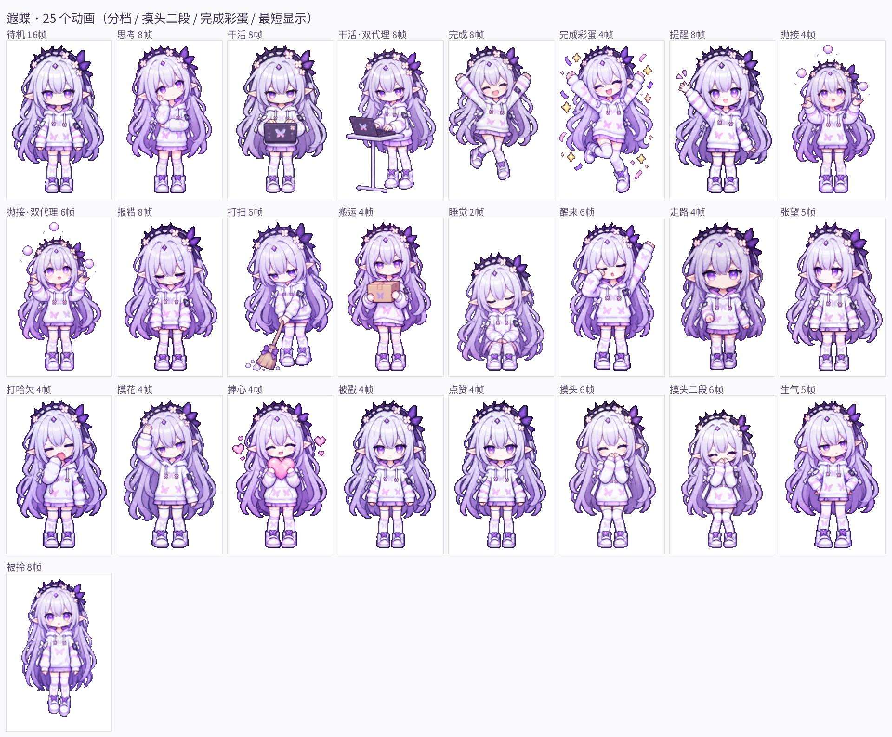

# 遐蝶 · dsh-go 像素宠物

给 **dsh-go**（DeepSeek Harness 手机版）用的像素宠物包。角色「遐蝶」的同人二创像素画，113×170 画布，25 个动画，逐帧节奏（每帧单独的 ms）。



## 安装

1. 下载 [`out/遐蝶.zip`](out/遐蝶.zip)
2. 打开 dsh-go → 设置 → 宠物 → 导入，选择这个 zip（同 id `astral-pixel` 会覆盖旧包）

## 动画（25）

| 分组 | 动画 |
|---|---|
| 状态 | `idle` 待机、`thinking` 思考、`working` 干活（1 个会话）、`working2` 干活·双代理（≥2 个子代理）、`done` 完成、`error` 报错、`notification` 提醒、`sweeping` 打扫、`carrying` 搬运、`sleep` 睡觉、`waking` 醒来、`walk` 走路 |
| 反应 | `tap` 被戳、`praise` 点赞、`tickle` 摸头、`tickle2` 摸头二段、`annoyed` 生气、`drag` 被拎 |
| 待机小剧场 | `gaze` 张望、`yawn` 打哈欠、`flower` 摸花、`smile` 捧心 |
| 彩蛋 | `cheer2` 完成时 30% 概率 |

几个实现细节：

- `tiers`：`working` / `juggling` 各分两档，子代理数 ≥2 时切到 `working2` / `juggling2`。
- `tickle2`：由 tickle 姿势整体压扁（0.94 → 0.85，脚底不动）做出"笑到弯腰"，`reactions` 里用平铺字符串键，旧版 App 的兼容校验仍能通过。
- `timings`：`minDisplay` 给 error 1600ms、notification 1800ms、attention 1200ms、sweeping 5600ms、carrying 3200ms；`autoReturn` 给 attention 4000ms、sweeping 300000ms、carrying 3200ms。

## 结构

```
build.py             姿势图 → 统一像素格 → 动画帧（写入 frames/ + preview/）
pack_build.py        打包，补 tiers / bonus / timings，输出 out/astral-pixel/
make_overview.py     拼 out/总览.png
assets/              参考图、设定图、4 帧走路精灵图
previews/            每个动画一张 GIF 预览
out/遐蝶.zip         可直接导入的宠物包
NOTES.md             工程说明（动画清单、命名坑、改法）
PIPELINE.md          从参考图到成品包的完整流水线
```

## 重建（可选）

`pack_build.py` 复用了 dsh-go 自带的 `pet-theme` 技能脚本（`make_pet_pack.py`），
需要本机装有 dsh-go 并提供 `~/.dsh/skills/pet-theme/scripts/`：

```sh
python3 build.py && python3 pack_build.py && python3 make_overview.py
python3 ~/.dsh/skills/pet-theme/scripts/pet_pack_check.py out/astral-pixel --compat-reactions
```

依赖 Pillow、numpy。注意不要用官方 `pet_theme_convert.py` 的逐帧模式重打包：
会丢 `bonus` / `timings`。原始姿势大图（`assets/poses/`）因体积与授权未收录。

## 授权

- 代码（`*.py`）：MIT，见 [LICENSE](LICENSE)。
- 角色「遐蝶」与美术素材：**同人二创**，角色版权归原权利人（《崩坏：星穹铁道》/ 米哈游）。
  仅供学习交流，**禁止商用**；权利人如有异议，我会立即删除相关内容。
