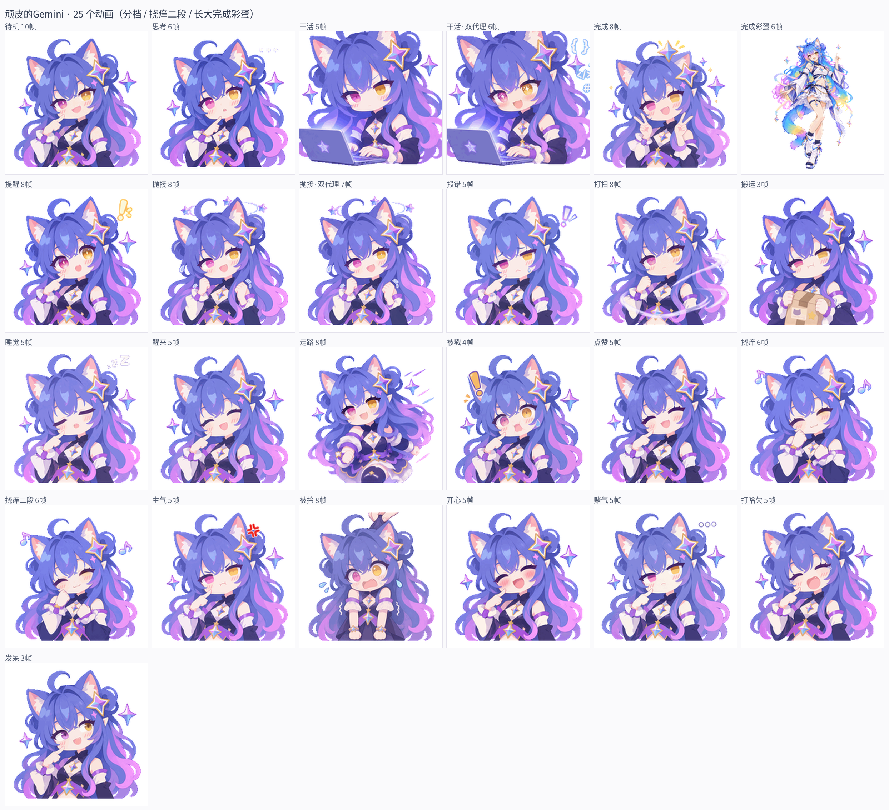

# 顽皮的Gemini · dsh-go 宠物包

给 **dsh-go**（DeepSeek Harness 手机版）用的宠物包。200×200 画布，平滑绘制（`pixelArt: false`），25 个动画。



## 安装

1. 下载 [`out/naughty-gemini.zip`](out/naughty-gemini.zip)
2. 打开 dsh-go → 设置 → 宠物 → 导入，选择这个 zip（同 id `naughty-gemini` 会覆盖旧包）

## 动画（25）

| 分组 | 动画 |
|---|---|
| 状态 | `idle` 待机、`thinking` 思考、`working` 干活（1 个会话）、`working2` 干活·双代理（≥2 个子代理）、`done` 完成、`error` 报错、`notification` 提醒、`sweeping` 打扫、`carrying` 搬运、`sleep` 睡觉、`waking` 醒来、`walk` 游走 |
| 反应 | `tap` 被戳、`praise` 点赞、`tickle` 挠痒、`tickle2` 挠痒二段、`annoyed` 嫌弃、`drag` 被拎 |
| 待机小剧场 | `happy` 开心、`pout` 赌气、`yawn` 打哈欠、`gaze` 发呆 |
| 分档 | `working2` 干活·双代理、`juggling2` 抛接·双代理 |
| 彩蛋 | `cheer2` 完成时 30% 概率长大成成年形态（透明立绘） |

干活状态有电脑和键盘：打开的迷你笔记本、屏幕蓝紫光、双手敲键盘，两套画面交替，
其中一套旁边漂着 `{ }` `</>` `#` 代码符号。星星、汗滴、怒气、Zzz、太阳、感叹号都由图像模型
直接画在表情图上，本地只做呼吸、弹跳、抖动。

## 结构

```
gen2.py             生成 26 张透明表情/动作（含 work1/work2、done2、cheer2 长大版）
build2.py           表情 → 状态 GIF（工作帧放大 1.18；tickle2 压扁、juggling2 高抛、cheer2 长大版）
pack2.py            打包 + timings / bonus + 校验 + zip
scripts-200canvas/  pet-theme 脚本副本（只把 SMOOTH_CANVAS 改成 200）
ref/ref.jpg         角色参考图
previews/           25 个动画的 GIF 预览
out/naughty-gemini.zip  可直接导入的宠物包
README-源码.md      源码归档说明
说明.md             成品说明
```

## 重建（可选）

```sh
python3 build2.py && python3 pack2.py
python3 ~/.dsh/skills/pet-theme/scripts/pet_pack_check.py out-naughty-gemini --compat-reactions
```

依赖 Pillow、numpy，以及 dsh-go 自带的 `pet-theme` 技能脚本（`scripts-200canvas/` 是它的副本）。
原始透明表情（`trans/`）因体积与授权未收录，可用 `gen2.py` 重新生成。

## 授权

- 代码（`*.py`）：MIT，见 [LICENSE](LICENSE)。
- 角色与美术素材：同人创作，角色版权归原权利人。仅供学习交流，**禁止商用**；
  权利人如有异议，我会立即删除相关内容。
