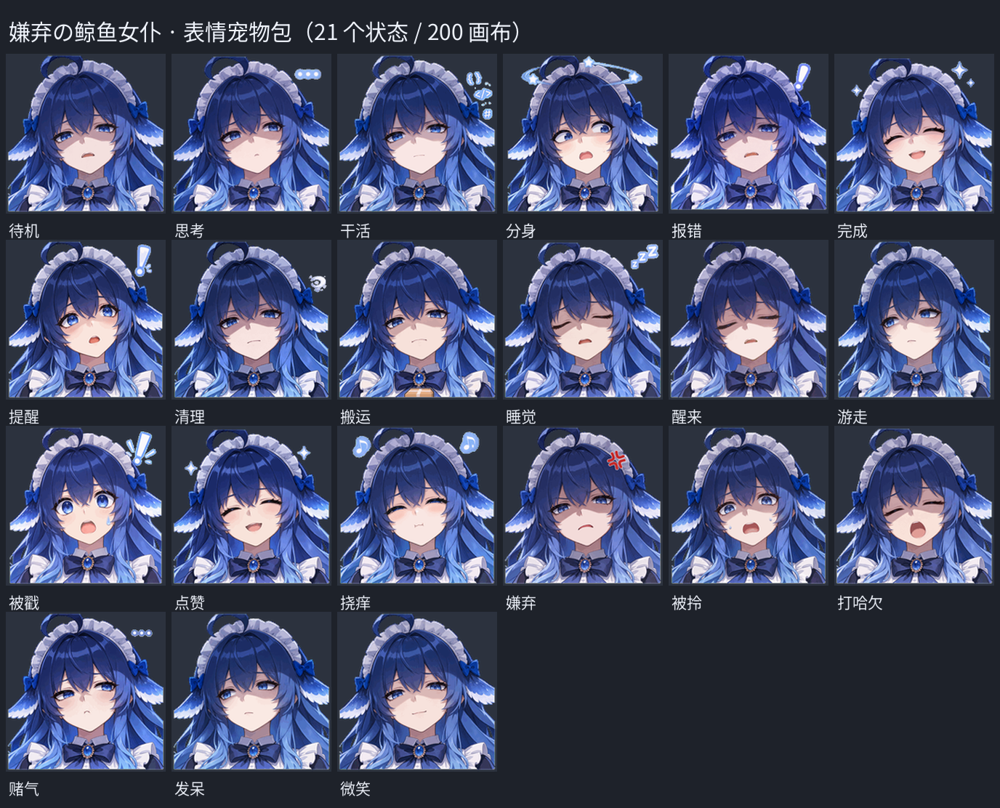

# 嫌弃の鲸鱼女仆 · dsh-go 宠物包

给 **dsh-go**（DeepSeek Harness 手机版）用的宠物包。200×200 画布，平滑绘制（`pixelArt: false`），22 个动画，全部由 GIF 合成。



## 安装

1. 下载 [`out/whale-maid.zip`](out/whale-maid.zip)
2. 打开 dsh-go → 设置 → 宠物 → 导入，选择这个 zip（同 id `whale-maid` 会覆盖旧包）

## 动画（22）

| 分组 | 动画 |
|---|---|
| 状态 | `idle` 待机、`thinking` 思考、`working` 干活（1 个会话）、`working2` 干活·双代理（≥2 个子代理）、`done` 完成、`error` 报错、`notification` 提醒、`sweeping` 打扫、`carrying` 搬运、`sleep` 睡觉、`waking` 醒来、`walk` 游走 |
| 反应 | `tap` 被戳、`praise` 点赞、`tickle` 挠痒、`annoyed` 嫌弃、`drag` 被拎 |
| 待机小剧场 | `yawn` 打哈欠、`pout` 赌气、`gaze` 发呆、`smile` 微笑 |

符号（代码符号、汗滴、怒气、Zzz、星星、音符）由图像模型直接画进表情图，本地只做呼吸、抖动、眨眼。

## 结构

```
gen_faces.py        生成 12 张透明表情（同构图只改脸）
gen_symbols.py      生成 17 张带符号表情
build_all.py        表情帧 → 状态 GIF（呼吸 / 眨眼 / 抖动）
pack.py             调转换器打包 + 补 timings / bonus + 校验 + 打 zip
scripts-200canvas/  pet-theme 脚本副本（只把 SMOOTH_CANVAS 改成 200）
ref/ref.jpg         角色参考图
previews/           22 个动画的 GIF 预览
out/whale-maid.zip  可直接导入的宠物包
README-源码.md      源码归档说明
说明.md             成品说明
```

## 重建（可选）

```sh
python3 build_all.py && python3 pack.py
python3 ~/.dsh/skills/pet-theme/scripts/pet_pack_check.py out-whale-maid --compat-reactions
```

依赖 Pillow、numpy，以及 dsh-go 自带的 `pet-theme` 技能脚本（`scripts-200canvas/` 是它的副本）。
原始透明表情（`trans/`、`symbols/`）因体积与授权未收录，可用 `gen_faces.py` / `gen_symbols.py` 重新生成。

## 授权

- 代码（`*.py`）：MIT，见 [LICENSE](LICENSE)。
- 角色与美术素材：同人二创，角色版权归原权利人。仅供学习交流，**禁止商用**；
  权利人如有异议，我会立即删除相关内容。
